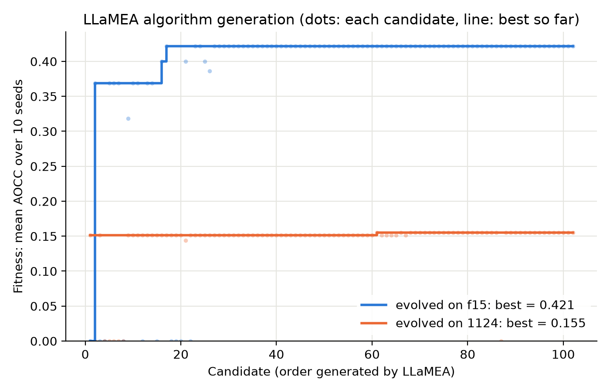
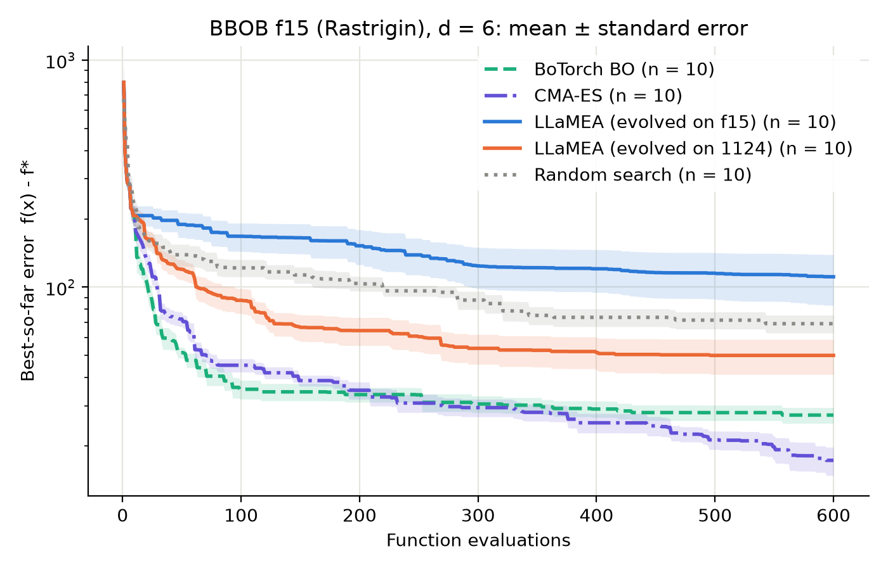
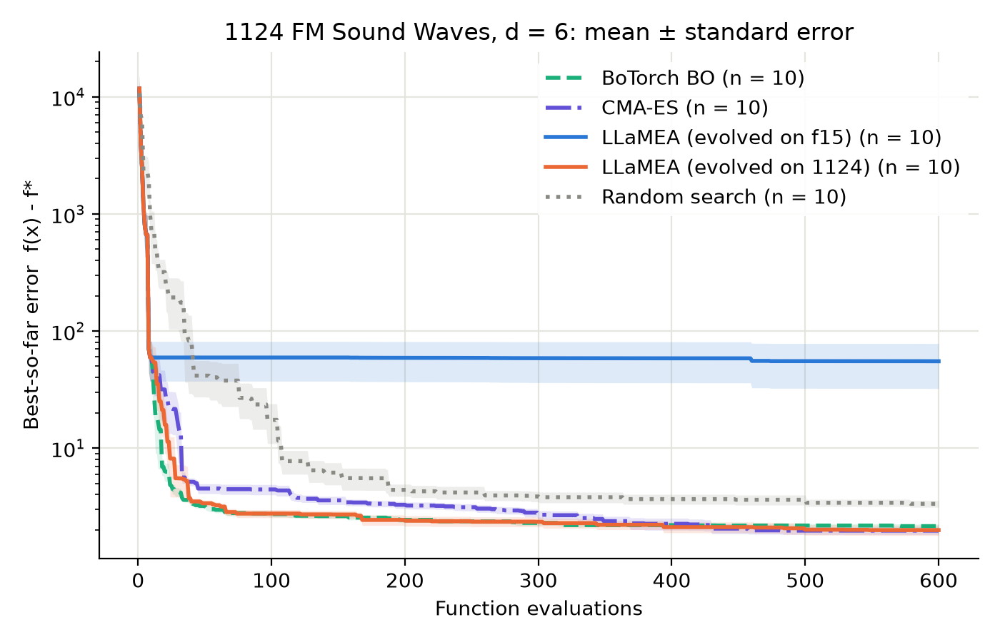

# LLaMEA-BO: Generating and Benchmarking Bayesian Optimization Algorithms

**Bayesian Optimization 2026–2027 · Practical Assignment · Group 12**

This repository contains the full pipeline for (1) using [LLaMEA](https://github.com/XAI-liacs/LLaMEA) to generate Bayesian Optimization (BO) algorithms on one COCO-BBOB function and one real-world problem, and (2) benchmarking the generated algorithms against CMA-ES and a BoTorch BO baseline to study generalization.

> **Status note:** Items marked `[TODO: ...]` are the only remaining placeholders and must be completed before submission.

## Contents

| # | Section | # | Section |
| :-- | :-- | :-- | :-- |
| 1 | [Overview](#1-overview) | 6 | [Running Experiments](#6-running-experiments) |
| 2 | [Repository Structure](#2-repository-structure) | 7 | [Generated Algorithms](#7-generated-algorithms-component-analysis--pseudocode) |
| 3 | [Environment Setup](#3-environment-setup--installation) | 8 | [Results & Output Files](#8-results--output-files) |
| 4 | [LLM Provider Configuration](#4-llm-provider-configuration) | 9 | [Attribution & References](#9-attribution--references) |
| 5 | [Prompts & Hyperparameters](#5-configuring-prompts--hyperparameters) | | |

---

## 1. Overview

### 1.1 Assigned Targets

| Parameter | Value / Details |
| :--- | :--- |
| **Group ID ($g$)** | `12` |
| **Random seeds** ($s_{g,r} = 10g + r$, $r = 0,\dots,9$) | `120, 121, 122, 123, 124, 125, 126, 127, 128, 129` |
| **Dimensionality** | $d = 6$ |
| **BBOB function (instance 1)** | `f15`: Rastrigin |
| **Real-world problem** | `1124`: Frequency Modulated Sound Waves ([source](https://github.com/BayesOptApp/Practical_Problems/blob/main/Practical_Problems/Problems/Frequency_Modulated_Sound_Waves.m)) |
| **Objective convention** | All problems are **minimization** tasks. Inside LLaMEA, candidates are ranked by maximizing the **Area Over the Convergence Curve (AOCC)**. |

### 1.2 Experimental Protocol

| Setting | Stage 1: Algorithm Generation | Stage 2: Generalization Evaluation |
| :--- | :--- | :--- |
| **Outer-loop budget** | ≤ `100` candidate algorithms per LLaMEA search | n/a |
| **Function evaluations per run** | `10d = 60` (incl. initialization) | `100d = 600` (incl. initialization) |
| **Independent runs** | `10` per candidate (seeds `120–129`) | `10` per algorithm/problem pair (seeds `120–129`) |
| **Selection / reporting metric** | Mean AOCC over 10 runs | Best-so-far objective vs. evaluations (mean ± variability) |
| **Methods** | LLaMEA candidates | 2 generated algorithms + CMA-ES + BoTorch BO (+ Random Search as an extra reference) |

### 1.3 Assignment Requirement Map

| Requirement | Where addressed |
| :--- | :--- |
| Environment setup & dependencies | [§3](#3-environment-setup--installation) |
| LLM provider configuration | [§4](#4-llm-provider-configuration) |
| Running LLaMEA and benchmarking against baselines | [§6](#6-running-experiments) |
| Prompt & hyperparameter configuration | [§5](#5-configuring-prompts--hyperparameters) |
| Pseudocode / workflow of generated codebases | [§7](#7-generated-algorithms-component-analysis--pseudocode) |
| Hardware used for the evaluation protocol | [§3.1](#31-hardware--execution-profile) |
| Logs and convergence plots (LLaMEA AOCC, BBOB loss, real-world objective) | [§8](#8-results--output-files) |
| Acknowledgement of external code and references | [§9](#9-attribution--references) |
---

## 2. Repository Structure

| Path / File | Role |
| :--- | :--- |
| `config/config.py` | `ExperimentConfig` (seeds, budgets, AOCC bounds) and `ModelConfig` (LLM settings) |
| `stage1/bo_gen.py` | Stage 1 entry point: LLaMEA generation for both targets |
| `stage1/evaluator.py` | Inner-loop evaluator: runs each candidate over all seeds and computes AOCC |
| `stage1/utils.py` | AOCC logger, AOCC correction/aggregation, error formatting |
| `stage1/model/client.py` | `OllamaWrapper` LLM client |
| `stage1/prompts/exp_prompts.py` | Experimental role/task prompts (`prompts.py` holds earlier exploratory prompts) |
| `stage2/runner.py` | Stage 2 entry point: problem construction and benchmarking of all methods |
| `BBOB_Optimize_with_BO` (`bbob_Optimize_with_BO.py`) | Best algorithm generated on `f15` |
| `Real_Optimize_with_BO` (`real_Optimize_with_BO.py`) | Best algorithm generated on problem `1124` |
| `botorch_bo.py` | BoTorch BO baseline |
| `cmaes.py` | CMA-ES baseline (`pycma`) |
| `plots/plot_llamea.py`, `plots/plot_convergence.py` | Plotting scripts |
| `llamea_logs/`, `results/`, `plots/output/` | Generation logs, raw results, figures |

---

## 3. Environment Setup & Installation

### 3.1 Hardware & Execution Profile

| Component / Metric | Specification / Details |
| :--- | :--- |
| **CPU** | Intel Core i7-14700 (20 cores / 28 threads, up to 5.4 GHz) |
| **GPU** | NVIDIA GeForce RTX 4060 (8 GB VRAM, CUDA 13.2) |
| **Stage 1 runtime** | ~5–7 h per LLaMEA evolutionary loop |
| **Stage 2 runtime** | ~5–7 h for all baselines and generalization runs (dominated by GP-based BO) |
| **CPU vs. GPU** | Stage 1 evaluation loop and Stage 2 benchmarking run on the **CPU**. The local LLM is served on the **GPU**. The LLM can also run on CPU with ≥ 16 GB system RAM (~10 GB for the quantized model). With a free external API tier, no local GPU is required. |

### 3.2 Software Dependencies

| Package / Runtime | Version | Purpose |
| :--- | :--- | :--- |
| `python` | `3.11` | Runtime |
| `botorch` | `0.18.1` | GP surrogates and acquisition functions |
| `ioh` | `0.3.22` | COCO-BBOB / practical problem interface |
| `llamea` | `1.4.2` | LLM-driven evolutionary algorithm generation |
| `cma` | `4.5.0` | `pycma` CMA-ES baseline |
| `torch`, `gpytorch`, `numpy`, `scipy` | pinned in `requirements.txt` | Numerical backend used by the generated algorithms and baselines |

### 3.3 Installation

```bash
# 1. Install the uv package manager
curl -LsSf https://astral.sh/uv/install.sh | sh                                    # Linux / macOS
# powershell -ExecutionPolicy ByPass -c "irm https://astral.sh/uv/install.ps1 | iex"  # Windows

# 2. Create and activate the environment (from the repository root)
uv venv .venv --python python3.11
source .venv/bin/activate
uv pip install -r requirements.txt
```

---

## 4. LLM Provider Configuration

### 4.1 Selected Free-to-Use Model

| Setting | Configuration |
| :--- | :--- |
| **Serving engine** | Local, via **Ollama** (`GGUF` format) |
| **Model** | [`Qwen/Qwen2.5-Coder-14B-Instruct-GGUF`](https://huggingface.co/Qwen/Qwen2.5-Coder-14B-Instruct-GGUF/blob/main/qwen2.5-coder-14b-instruct-q4_k_m.gguf) |
| **Quantization** | `Q4_K_M` |
| **Memory footprint** | ~8.99 GB VRAM / RAM (8 GB+ VRAM recommended) |
| **Endpoint** | `http://localhost:11434/v1` (set via `OPENAI_API_BASE` in `config/config.py`) |

Defaults in `ModelConfig` (`config/config.py`):

| Parameter | Value |
| :--- | :--- |
| `model_name` | `qwen2.5-coder-14b-q4:latest` (**must match a name listed by `ollama list`**) |
| `temperature` | `0.3` |
| `top_p` | `0.95` |
| `context_window` (`num_ctx`) | `16384` |

> No LLM sampling seed is exposed, so Stage 1 is not bit-for-bit reproducible. The retained logs are the verifiable record of the generation run (see [§6.1](#61-reproducibility--randomness-control)).

### 4.2 Serving Instructions

**Step 1. Install Ollama (Linux).**

```bash
wget https://github.com/ollama/ollama/releases/latest/download/ollama-linux-amd64.tar.zst
tar -I zstd -xf ollama-linux-amd64.tar.zst

# Optional (remote machines): custom host and model storage
echo 'export OLLAMA_HOST="0.0.0.0:11434"' >> ~/.bashrc
echo 'export OLLAMA_MODELS="/local/user/ollama/ollama_data"' >> ~/.bashrc
source ~/.bashrc
```

**Step 2. Load the model** (choose one option).

| Option | Use case | Commands |
| :--- | :--- | :--- |
| **A** | Local machine with direct downloads | 1. `ollama serve &`<br> 2. <br>`ollama pull hf.co/Qwen/Qwen2.5-Coder-14B-Instruct-GGUF:Q4_K_M`<br> 3. <br>`ollama cp hf.co/Qwen/Qwen2.5-Coder-14B-Instruct-GGUF:Q4_K_M qwen2.5-coder-14b-q4` |
| **B** | Remote GPU machine with restricted downloads | See below |

```bash
# Option B: download locally, then transfer to the remote machine
curl -LsSf https://llama.app/install.sh | sh
llama cli -hf Qwen/Qwen2.5-Coder-14B-Instruct-GGUF --model qwen2.5-coder-14b-instruct-q4_k_m.gguf  # ~15–30 min
llama-gguf-split --merge path_to_shard_1
scp your_downloaded_model.GGUF username@domain:/path_to_your_remote

# On the remote machine
echo "FROM ./Qwen2.5-Coder-14B-Q4_K_M.gguf" > Modelfile
ollama create qwen2.5-coder-14b-q4 -f Modelfile
ollama serve &
```

**Step 3. Verify the endpoint** and adjust `model_name`, `temperature`, `top_p` in `config/config.py` if needed.

```bash
curl "http://localhost:11434/v1/models"
```

---

## 5. Configuring Prompts & Hyperparameters

### 5.1 LLaMEA Evolutionary Settings

| Setting | Value / Description |
| :--- | :--- |
| **Strategy** | $(\mu + \lambda) = (2 + 5)$, elitism enabled |
| **Parents ($\mu$) / Offspring ($\lambda$)** | `2` / `5` |
| **Rationale** | In preliminary trials, $(1,1)$ and $(1+1)$ rarely produced syntactically valid code with the local 14B model. Li et al. (2026) report $(8+16)$ as optimal, but $(2+5)$ gave the best trade-off between code validity and runtime. |
| **Library modifications** | None to the core `llamea` package. The evaluator and logging pipeline are adapted from the official [black-box optimization example](https://github.com/XAI-liacs/LLaMEA/blob/main/examples/black-box-optimization.py). |

### 5.2 Experiment Configuration (`ExperimentConfig`)

| Parameter | Value | Meaning |
| :--- | :--- | :--- |
| `group_number` | `12` | Determines seeds `10·g + r` |
| `seeds` | `[120 … 129]` | Generated automatically in `__post_init__` |
| `llamea_budget` | `100` | Outer-loop candidate budget |
| `dimension` | `6` | Problem dimension |
| `initial_points` | `10` | Initial design size (counts toward the budget) |
| `llamea_function_budget` | `60` | Inner-loop evaluations (`10d`) |
| `experiment_evaluation_budget` | `600` | Stage 2 evaluations (`100d`) |
| `lower`, `upper` | `1e-2`, `1e3` | Objective range used by the AOCC logger; found through trials with random search.  on both poroblems. |
| `fall_back` | `0` | Score assigned to candidates that crash or are invalid |

### 5.3 Prompt Strategies

All experimental prompts live in `stage1/prompts/exp_prompts.py`. The role prompt is shared:

```python
ENGINEERED_ROLE_PROMPT = "You are an AI that generates Python optimization code by using Bayesian Optimization."
```

| Prompt | Strategy | Key characteristics |
| :--- | :--- | :--- |
| `BO_STUB_TASK_PROMPT_1` | **Rule-driven minimal stub** | Only the class interface (`__init__`, `__call__`) plus seven groups of guardrails derived from iterative error analysis (see table below). Gives the LLM the most freedom over algorithm structure. |
| `BO_STUB_TASK_PROMPT_2` | Stub + coordinate rules | As above, plus rule 8: keep `train_X` in `[0,1]`, call `unnormalize` once before evaluating, re-create the GP instead of `set_train_data`, and keep fallback candidates in the correct coordinate frame. |
| `BO_SKELETON_TASK_PROMPT` | **Concrete code skeleton** | A complete working BoTorch baseline (log10 transform → standardize → negate, `qLogExpectedImprovement`); the LLM makes 1–2 targeted changes. Reduces import and shape errors. |

The reported runs use `BO_STUB_TASK_PROMPT_1` (logs in `llamea_logs/BO_STUB_TASK_PROMPT_1/`).

<details>
<summary>Guardrail rules in <code>BO_STUB_TASK_PROMPT_1</code></summary>

| # | Rule group | Purpose |
| :-- | :--- | :--- |
| 1 | Objective function contract | Call `func` with a 1D `list[float]`; cast outputs to `float` |
| 2 | Bounds handling & scaling | Read `func.bounds` safely; optimize in `[0,1]^d` (`float64`); `unnormalize` takes a single `(2, d)` tensor |
| 3 | Minimization → maximization consistency | Negate targets; `best_f` must lie on the same transformed scale as `train_Y`; use `fit_gpytorch_mll` and `covar_module=` |
| 4 | Budget & numerical stability | Sobol initial design; track `n_evals` strictly; `num_restarts ≤ 5`, `raw_samples ≤ 64`; `try/except` around GP fit and acquisition |
| 5 | Multimodal / AOCC strategy | Hints: target warping, ARD Matérn-5/2, decaying-β UCB, trust-region refinement |
| 6 | Explicit imports | Import every symbol (`MaternKernel`, `qLogExpectedImprovement`) explicitly |
| 7 | Acquisition & fallback safety | No unverified `beta=` argument; fall back to a valid candidate instead of returning early; consistent tensor shapes |
| — | Evolutionary refinement instruction | If `fitness == 0` fix the traceback root cause; otherwise propose a meaningfully distinct variation |

The full prompt text is in `stage1/prompts/exp_prompts.py`.

</details>

---

## 6. Running Experiments

### 6.1 Reproducibility & Randomness Control

| Component | Seed handling |
| :--- | :--- |
| **Stage 1 evaluation** | `Evaluator` (`stage1/evaluator.py`) loops over seeds `120–129`. For each seed it calls `np.random.seed(seed)` and passes `random_seed=seed` to the candidate. Invalid or crashing code receives the fallback score `0`. |
| **Generated algorithms** | `torch.manual_seed` and `np.random.seed` in `__init__`; scrambled `SobolEngine(seed=random_seed)` for the initial design. |
| **BoTorch baseline** | `torch.manual_seed(seed)`, `np.random.default_rng(seed)` for the fallback, scrambled Sobol with `seed=random_seed`. |
| **CMA-ES baseline** | Scrambled Sobol with `seed=random_seed`; `pycma` seed `random_seed·100 + restart_index` for each restart. |
| **AOCC aggregation** | Per-seed AOCC values and their mean / standard deviation are stored in solution metadata (`aucs`, `auc_mean`, `auc_std`) via `stage1/utils.py`. |

> **Important:** `Evaluator` defaults to `testing=True`, which evaluates only the **first seed**. Production Stage 1 runs must construct it with `testing=False` so all 10 seeds are used.

**Sources of randomness that cannot be fully controlled:**

* LLM generation (no sampling seed is configured), so Stage 1 outputs vary between runs.
* Multi-threaded floating-point reductions in PyTorch and the L-BFGS-B optimizers inside `optimize_acqf` / `scipy`, which can cause small run-to-run numerical differences even with fixed seeds.

### 6.2 Execution Commands

Run all commands from the **repository root**.

| Step | Command | Output |
| :--- | :--- | :--- |
| **1. Stage 1: generation** (both targets) | `python -m stage1.bo_gen` | `llamea_logs/` |
| **2. Stage 2: benchmarking** (copy the selected algorithms into the matching prompt subfolder of `algorithms/` first) | `python -m stage2.runner` | `results/stage2/` |
| **3a. LLaMEA AOCC convergence plot** | `python -m plots.plot_llamea` | `plots/output/llamea_aocc.pdf` |
| **3b. Stage 2 convergence plots** | `python -m plots.plot_convergence` | `plots/output/convergence_*.pdf` |

### 6.3 Baseline Configuration (Stage 2)

All methods use the same dimension (`6`), budget (`600`), seeds (`120–129`) and initial design size (`10` scrambled Sobol points counted toward the budget; Random Search has no initial design).

| Property | BoTorch BO (`botorch_bo.py`) | CMA-ES (`cmaes.py`) | Generated algorithms |
| :--- | :--- | :--- | :--- |
| **Initialization** | Scrambled Sobol, 10 pts | Scrambled Sobol, 10 pts; best point seeds first run | Scrambled Sobol, 10 pts |
| **Search box** | `[-5, 5]^d` (hard-coded) | `[-5, 5]^d` (hard-coded) | Read from `func.bounds` (fallback `[-5, 5]^d`) |
| **Surrogate** | `SingleTaskGP` + `Normalize` input and `Standardize` output transforms, fit on `-y` | n/a | `SingleTaskGP`, ARD Matérn-5/2 (see §7) |
| **Acquisition** | `LogExpectedImprovement`, `num_restarts=10`, `raw_samples=256` | n/a | `qLogExpectedImprovement`, `q=1`, `num_restarts=5`, `raw_samples=64` |
| **Search strategy** | Refit GP every iteration | IPOP-style restarts: $\sigma_0 = 2.5$, population $4 + \lfloor 3\ln d \rfloor = 9$, doubled at every restart, random restart points | See §7 |
| **Failure fallback** | Uniform random point | n/a | See §7 |

---

## 7. Generated Algorithms: Component Analysis & Pseudocode

### 7.1 Component Comparison

| Component | Standard BO (BoTorch baseline) | `BBOB_Optimize_with_BO` (f15) | `Real_Optimize_with_BO` (1124) |
| :--- | :--- | :--- | :--- |
| **Initial design** | Scrambled Sobol | Scrambled Sobol | Scrambled Sobol |
| **Input handling** | `Normalize` transform | Initial points in `[0,1]^d`; later candidates are proposed in domain coordinates (see 7.4) | Normalized to `[0,1]^d`; acquisition optimized on `[0,1]^d` |
| **Output handling** | Negate + `Standardize` | Raw `y` (no negation) | Raw `y` (no negation) |
| **Surrogate** | `SingleTaskGP` | `SingleTaskGP`, ARD Matérn-5/2 | `SingleTaskGP`, ARD Matérn-5/2 |
| **Acquisition** | `LogExpectedImprovement` | `qLogExpectedImprovement` | `qLogExpectedImprovement` |
| **`best_f` reference** | `max(-y)` (standardized) | `max(train_Y)` on raw values | `min(Y)` on raw values |
| **Local search** | None | Periodic L-BFGS-B around the incumbent (every 10 iterations) | Gaussian perturbation of the incumbent, $\mathcal{N}(0, 0.1^2)$ |
| **Model update** | Refit from scratch | `set_train_data` + refit | `set_train_data` + refit |
| **Failure handling** | Random fallback point | Acquisition failure → incumbent; GP-fit failure → return `(inf, 0)` | Acquisition failure → Sobol draw; GP-fit failure → return `(inf, 0)` |

### 7.2 Algorithm Generated on the BBOB Function (`BBOB_Optimize_with_BO`)

| Component | Description |
| :--- | :--- |
| **Initialization** | Scrambled Sobol sequence in $[0,1]^d$, scaled to `[lb, ub]`; evaluates `n_init` points. |
| **Surrogate model** | `SingleTaskGP` with ARD Matérn-5/2 kernel (`MaternKernel(nu=2.5, ard_num_dims=dim)`), fit via `ExactMarginalLogLikelihood`, with raw objective values as targets. |
| **Acquisition** | `qLogExpectedImprovement` (`q=1`, `num_restarts=5`, `raw_samples=64`); falls back to the incumbent if optimization fails. |
| **Local refinement** | When `n_evals mod 10 == 0`, runs `scipy.optimize.minimize` (L-BFGS-B) from the incumbent within `[lb, ub]` to exploit promising basins. |

**Tunable constants:** `n_init` (via `initial_points`), `num_restarts=5`, `raw_samples=64`, refinement period `10`.

```text
Algorithm 1: BBOB_Optimize_with_BO
Input: budget B, dimension d, initial_points n_init, seed s
1. Seed PyTorch and NumPy with s; read bounds [lb, ub] from func.
2. Draw n_init scrambled-Sobol points X_init in [0,1]^d; scale to X_scaled.
3. Evaluate Y_init = func(X_scaled); set train_X = X_init, train_Y = Y_init, n_evals = n_init.
4. Fit SingleTaskGP (ARD Matern-5/2) via ExactMarginalLogLikelihood.
5. best_x = argmin(Y_init); best_f_max = max(train_Y).
6. While n_evals < B:
     a. c <- argmax qLogExpectedImprovement(model, best_f = best_f_max)   (fallback: best_x)
     b. c_scaled <- unnormalize(c, [lb, ub]); evaluate candidate_f = func(c_scaled)
     c. Append (c, candidate_f) to (train_X, train_Y); refit the GP
     d. Update best_f_max / best_x if candidate_f improves on the incumbent
     e. If n_evals mod 10 == 0:
          run L-BFGS-B from best_x within [lb, ub]; update incumbent if improved
     f. n_evals <- n_evals + 1
7. Return (best_f_max, best_x)
```

### 7.3 Algorithm Generated on the Real-World Problem (`Real_Optimize_with_BO`)

| Component | Description |
| :--- | :--- |
| **Initialization** | Scrambled Sobol sequence in $[0,1]^d$, mapped linearly to `[lb, ub]`. |
| **Surrogate model** | `SingleTaskGP` with ARD Matérn-5/2 kernel, fit on unit-normalized inputs `X_normalized` and raw minimization values `Y`. |
| **Acquisition** | `qLogExpectedImprovement` optimized on the unit hypercube (`q=1`, `num_restarts=5`, `raw_samples=64`); falls back to a single Sobol draw if optimization fails. |
| **Perturbation refinement** | After each BO candidate, evaluates a Gaussian perturbation ($\sigma = 0.1$) of the incumbent, clipped to `[lb, ub]`, then updates the incumbent and refits the GP. |

**Tunable constants:** `n_init`, `num_restarts=5`, `raw_samples=64`, perturbation scale `0.1`.

```text
Algorithm 2: Real_Optimize_with_BO
Input: budget B, dimension d, initial_points n_init, seed s
1. Seed PyTorch and NumPy with s; read bounds [lb, ub] from func.
2. Draw n_init scrambled-Sobol points X_unit in [0,1]^d; scale to X_scaled.
3. Evaluate Y = func(X_scaled); X_normalized = normalize(X_scaled); n_evals = n_init.
4. Fit SingleTaskGP (ARD Matern-5/2) via ExactMarginalLogLikelihood.
5. best_f = min(Y); best_x = argmin(Y).
6. While n_evals < B:
     a. c <- argmax qLogExpectedImprovement(model, best_f = best_f) over [0,1]^d
        (fallback: Sobol draw)
     b. Evaluate y_c = func(c); append to Y; update best_f / best_x
     c. Append normalize(c) to X_normalized; refit the GP
     d. If y_c >= best_f (evaluated after the incumbent update):
          eps ~ N(0, 0.1^2 I); x_p = clip(best_x + eps, lb, ub)
          Evaluate y_p = func(x_p); update best_f / best_x if improved
          Append normalize(x_p) to X_normalized; refit the GP
     e. n_evals <- n_evals + 1
7. Return (best_f, best_x)
```

### 7.4 Implementation Observations (documented as submitted)

The generated code is reported **unmodified**. The following behaviors were identified by reading the source and are relevant when interpreting the Stage 2 results.

| # | Algorithm | Observation | Consequence |
| :-- | :--- | :--- | :--- |
| 1 | Both | Raw minimization values are used as GP targets and `best_f` without negation, although BoTorch acquisitions maximize. | The acquisition does not target improvement in the minimization sense. |
| 2 | `BBOB_…` | `optimize_acqf` runs over the **domain** bounds `[lb, ub]`, and the candidate is then passed through `unnormalize` again. Initial `train_X` is in `[0,1]`, while appended candidates are in domain units. | Candidates can map outside `[lb, ub]`; the GP training inputs mix two coordinate frames. |
| 3 | `BBOB_…` | `local_refinement` calls `unnormalize` on `best_x`, which is already in domain coordinates. | The refinement start point is mis-scaled. |
| 4 | `BBOB_…` | L-BFGS-B evaluations are not counted in `n_evals`. | Budget enforcement relies on the evaluation harness (`OverBudgetException` from the logger). |
| 5 | `Real_…` | The unit-cube candidate is passed to `func` **without** mapping back to `[lb, ub]`. | BO-proposed points are evaluated inside `[0,1]^d` only. |
| 6 | `Real_…` | The incumbent is updated before the check `y_candidate >= best_f`, so the condition is always true. | A perturbation evaluation happens at **every** iteration. |
| 7 | `Real_…` | The perturbation evaluation is not counted in `n_evals`. | Each iteration consumes two evaluations but increments the counter once; the harness truncates the run at the budget. |

---

## 8. Results & Output Files

### 8.1 Stored Artifacts

| Artifact | Path | Description |
| :--- | :--- | :--- |
| **Stage 1 generation logs** | `llamea_logs/BO_STUB_TASK_PROMPT_1/` | Prompts, LLM responses, generated code, iteration numbers, AOCC history |
| **Stage 2 raw results** | `results/stage2/first_results/` | Per-seed objective trajectories and summaries for every method and problem |
| **LLaMEA AOCC plot** | `plots/output/llamea_aocc.pdf` | Outer-loop AOCC progression over candidate evaluations |
| **BBOB convergence plot** | `plots/output/convergence_bbob.pdf` | Incumbent error vs. evaluations on `f15` (mean ± variability over 10 runs) |
| **Real-world convergence plot** | `plots/output/convergence_real.pdf` | Best objective vs. evaluations on problem `1124` (mean ± variability over 10 runs) |

### 8.2 Summary of Findings

<figure>
  
  <figcaption>Figure 1: Incumbent AOCC score against number number of generated algorithms. </figcaption>
</figure>

<figure>
  
  <figcaption>Figure 2: Incumbent error on f15 rastrigin for all algorithms. </figcaption>
</figure>

<figure>
  
  <figcaption>Figure 3: Incumbent error on practical problem 1124, Frequency Modulated Sound Waves, for all algorithms.  </figcaption>
</figure>

---

Final evaluation results for all algorithms on bbob and real problems. Error mean, median and standard error are reported for all runs and aggregated on the 10 seeds.  

| Problem | Algorithm | N Seeds | Final Error Mean | Final Error SE | Final Error Median |
|---|---|---:|---:|---:|---:|
| bbob | botorch_bo | 10 | 27.3355 | 2.1798 | 26.2666 |
| bbob | cmaes | 10 | 17.2782 | 2.4538 | 16.9443 |
| bbob | llamea_bbob | 10 | 111.1595 | 27.9567 | 94.9641 |
| bbob | llamea_real | 10 | 50.0772 | 8.8104 | 41.7768 |
| bbob | random_search | 10 | 69.0795 | 6.2579 | 68.9464 |
|---|---|---:|---:|---:|---:|
| real | botorch_bo | 10 | 2.1541 | 0.0831 | 2.1371 |
| real | cmaes | 10 | 1.9725 | 0.1459 | 1.9463 |
| real | llamea_bbob | 10 | 55.1481 | 22.9556 | 7.3285 |
| real | llamea_real | 10 | 1.9922 | 0.2008 | 2.1120 |
| real | random_search | 10 | 3.3424 | 0.2198 | 3.5295 |

---

## 9. Attribution & References

### 9.1 External Code

| Component | Source |
| :--- | :--- |
| Practical problem `1124` (Frequency Modulated Sound Waves) | [BayesOptApp/Practical_Problems](https://github.com/BayesOptApp/Practical_Problems/blob/main/Practical_Problems/Problems/Frequency_Modulated_Sound_Waves.m) |
| AOCC logging utilities | [LLaMEA `utils.py`](https://github.com/XAI-liacs/LLaMEA/blob/main/llamea/utils.py) |
| Evaluator & experiment skeleton | [LLaMEA examples](https://github.com/XAI-liacs/LLaMEA/tree/main/examples) |
| BoTorch baseline | Based on the course sample LLaMEA candidate: [BO_Course_Assignment](https://github.com/BayesOptApp/BO_Course_Assignment) (`sample_LLaMEA_logs/code/try-0-Optimize_with_BO.py`) |


### 9.2 References

1. Li, W., van Stein, N., Bäck, T., & Raponi, E. (2026). *LLaMEA-BO: A Large Language Model Evolutionary Algorithm for Automatically Generating Bayesian Optimization Algorithms*. GECCO '26, 909–918. ACM. https://doi.org/10.1145/3795095.3805059
2. van Stein, N., & Bäck, T. (2025). *LLaMEA: A Large Language Model Evolutionary Algorithm for Automatically Generating Metaheuristics*. IEEE Transactions on Evolutionary Computation, 29(2), 331–345. https://doi.org/10.1109/TEVC.2024.3497793
3. Hansen, N., Auger, A., Ros, R., Mersmann, O., Tušar, T., & Brockhoff, D. (2021). *COCO: A platform for comparing continuous optimizers in a black-box setting*. Optimization Methods and Software, 36(1), 114–144. https://doi.org/10.1080/10556788.2020.1808977
4. Hansen, N., Akimoto, Y., & Baudis, P. (2019). *CMA-ES/pycma on GitHub*. Zenodo. https://doi.org/10.5281/zenodo.2559634
